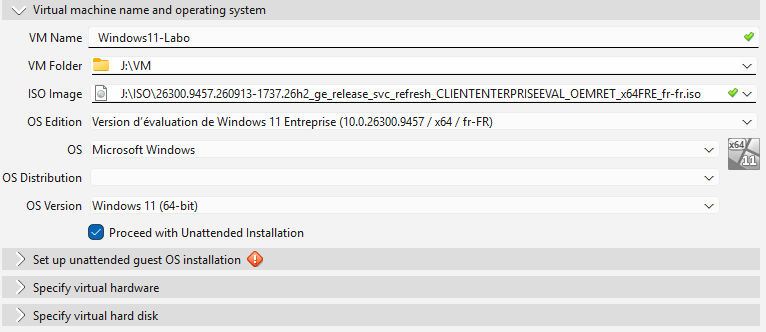
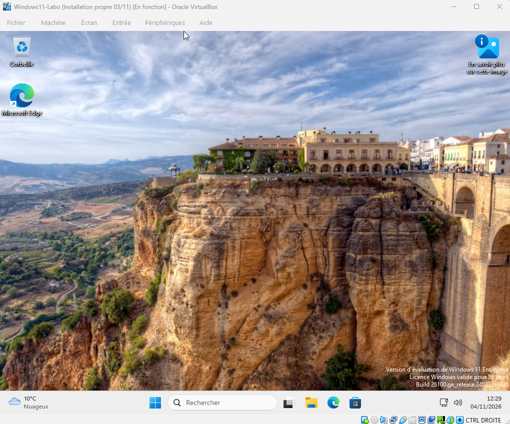
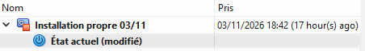
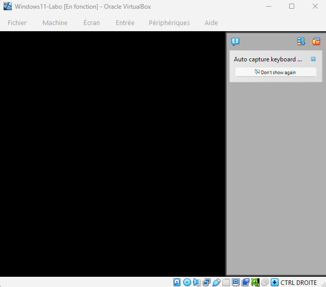
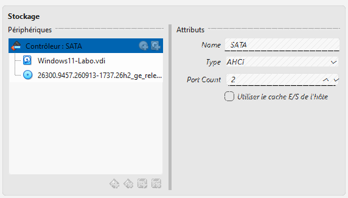
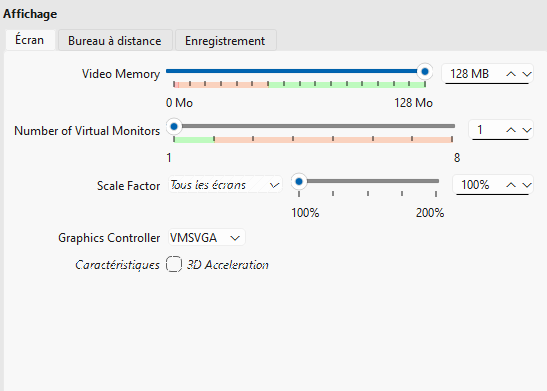

# Lab 04 – Installer une machine virtuelle Windows 11 sous VirtualBox

**Date :** 3 novembre 2026 (vérifications le 4)
**Compétences :** virtualisation, installation de Windows 11, dépannage d'affichage, instantanés (snapshots), organisation des disques

## Contexte

Pour mon labo maison, j'ai besoin de machines de test isolées de mon système principal : une VM Ubuntu (lab 03) et une VM Windows 11, pour travailler sur Active Directory, GPO et outils de support sans risque pour mon PC. Ce lab décrit la création de la VM Windows 11 et le problème d'écran noir rencontré au démarrage.

## Environnement

| Élément | Détail |
|---|---|
| Poste hôte | Windows, 16 Go de RAM |
| Disque | J: mécanique (HDD), 1 To libre, réservé aux machines virtuelles |
| Hyperviseur | VirtualBox |
| Système invité | Windows 11 Entreprise (version d'évaluation) |
| Fichier d'installation | ISO rangé dans `J:\ISO` |
| Dossier des machines | `J:\VM` |

## Réglages retenus

| Élément | Valeur | Pourquoi |
|---|---|---|
| Dossier par défaut des machines | `J:\VM` | Garder les VM hors du disque système |
| Disque virtuel | 64 Go, taille dynamique | Minimum exigé par Windows 11 ; l'espace n'est occupé qu'au fur et à mesure |
| Mémoire | 4 Go | Minimum exigé par Windows 11 |
| Processeurs | 2 | Suffisant pour le labo |
| Type de système | Windows 11 | VirtualBox active alors le TPM 2.0 et le démarrage sécurisé (EFI) |
| Installation automatique | Désactivée | Faire l'installation à la main pour comprendre chaque étape |
| Affichage | Contrôleur VMSVGA, mémoire vidéo 128 Mo, sans accélération 3D | Réglages finaux après le problème d'écran noir (voir plus bas) |

## Démarche

1. Créer le dossier `J:\VM`, puis le définir comme dossier par défaut dans VirtualBox (Fichier > Paramètres > Général).
2. Créer la VM avec les réglages ci-dessus et brancher l'ISO Windows 11. VirtualBox coche par défaut « Proceed with Unattended Installation » : je l'ai **décochée** avant de valider, pour faire l'installation moi-même (la capture ci-dessous a été prise avant ce changement).

   
3. Lancer l'installation. Sur un disque mécanique, elle est lente : compter plusieurs dizaines de minutes.
4. Vérifier le démarrage jusqu'au bureau.

   
5. Éteindre la VM proprement depuis Windows, puis créer un instantané **« Installation propre 03/11 »** pour pouvoir revenir à un état sain. Les autres mises à jour de Windows sont faites après, pour garder ce point de retour propre.

   

> La version d'évaluation de Windows 11 Entreprise est valable **90 jours**, donc jusqu'à début février 2027 environ.

## Problème rencontré : écran noir au démarrage

**Symptôme :** la VM est marquée « en fonction », mais l'écran reste noir au démarrage.

**Diagnostic :**
- Vérification de la configuration : ISO branchée sur le contrôleur SATA, virtualisation matérielle active dans le BIOS du PC, pas de mode Hyper-V qui gêne.

  
- Premier essai sur l'affichage : mémoire vidéo au maximum (128 Mo) et accélération 3D désactivée. **Sans effet**, l'écran restait noir. Ces réglages ont été conservés par la suite.
- Le clavier n'était pas capturé au message « Press any key » : je n'ai donc pas lancé le démarrage depuis le DVD d'installation.
- Pour savoir si le problème venait du démarrage ou de l'affichage, j'ai isolé la partie affichage.

**Cause :** le contrôleur graphique **VBoxSVGA**, proposé par défaut pour Windows 11, ne donnait pas d'affichage dans mon cas.

**Solution :** dans les paramètres de la VM (Affichage), passer le contrôleur graphique de **VBoxSVGA** à **VMSVGA**. Après démarrage, la VM affiche le bureau.

## Résultat

- VM Windows 11 installée et accessible jusqu'au bureau.
- Instantané « Installation propre 03/11 » créé.
- Problème d'écran noir identifié, expliqué et corrigé.

## Ce que j'ai appris

- **Un écran noir ne veut pas dire que la VM ne démarre pas.** Il faut séparer le démarrage (le système tourne-t-il ?) de l'affichage (la carte graphique virtuelle répond-elle ?).
- **Un réglage par défaut peut poser problème.** Le changer suffit parfois ; noter le réglage modifié permet de le retrouver plus tard.
- **Faire un instantané dès qu'une installation est propre** évite de tout recommencer après une mauvaise manipulation.
- **Côté support**, la même démarche s'applique à un poste qui n'affiche rien : vérifier l'alimentation et le câble, puis le pilote graphique, avant de conclure à une panne matérielle.
