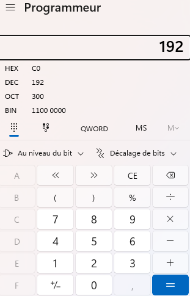
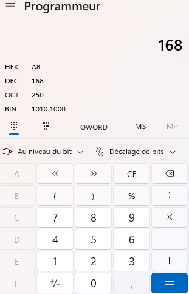
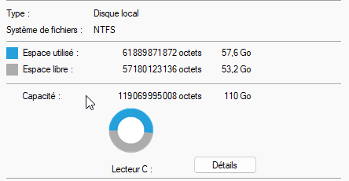
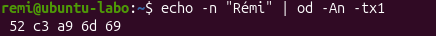
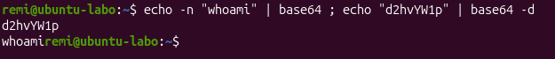
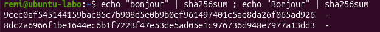

# Lab 05 – Binaire, encodage et hash : les bases vues par un analyste

**Date :** 9 novembre 2026
**Compétences :** conversion binaire/décimal/hexadécimal, unités de stockage (Go et Gio), encodage UTF-8, Base64, empreintes SHA-256

## Contexte

Trois notions reviennent tous les jours, en support comme en SOC :
- **Support :** expliquer à un utilisateur pourquoi son disque de « 1 To » affiche 931 Go, ou pourquoi sa fibre à 1 Gbit/s télécharge à 115 Mo/s.
- **SOC :** reconnaître une commande PowerShell encodée en Base64 dans un journal d'événements, et comparer l'empreinte (hash) d'un fichier suspect à une base de malwares connus.

Ce lab les manipule à la main, avec la Calculatrice Windows et le terminal de ma VM Ubuntu.

## Environnement

| Élément | Détail |
|---|---|
| Poste | Windows 11, Calculatrice en mode Programmeur |
| VM | Ubuntu (VirtualBox), terminal Bash |

## Démarche

### 1. Convertir en binaire avec la Calculatrice

Chaque position d'un octet vaut, de gauche à droite : 128, 64, 32, 16, 8, 4, 2, 1. Une adresse IP comme `192.168.1.10` est faite de 4 octets écrits de cette façon.

Calculatrice > menu ☰ > **Programmeur**, puis saisie du nombre et lecture de la ligne **BIN**.

| Décimal | Binaire | Hexadécimal | Calcul |
|---|---|---|---|
| 192 | 1100 0000 | C0 | 128 + 64 |
| 168 | 1010 1000 | A8 | 128 + 32 + 8 |





### 2. Comprendre l'écart entre capacité réelle et capacité affichée

Clic droit sur le disque `C:` > **Propriétés**.



Windows affiche **110 Go** pour une capacité de **119 069 995 008 octets**.

- Le fabricant compte en puissances de 10 : 1 Go = 1 000 000 000 octets, soit 119,07 Go.
- Windows compte en puissances de 2 : 1 Gio = 1 073 741 824 octets, soit 119 069 995 008 ÷ 1 073 741 824 = **110,9 Gio**, affichés « 110 Go ».

Il ne manque rien : la même quantité d'octets est exprimée avec deux unités différentes. Le disque ne fait pas non plus exactement la taille annoncée par le fabricant, car une partie sert aux partitions système.

### 3. Voir les octets, encoder et calculer une empreinte (Ubuntu)

**Octets d'un texte accentué.** Cette commande affiche « Rémi » octet par octet, en hexadécimal :

```bash
echo -n "Rémi" | od -An -tx1
```

Résultat : `52 c3 a9 6d 69`, soit **5 octets pour 4 caractères**. En UTF-8, « é » prend 2 octets (`c3 a9`) ; les caractères ASCII n'en prennent qu'un.



**Base64.** Cette commande encode `whoami`, puis décode le résultat :

```bash
echo -n "whoami" | base64 ; echo "d2hvYW1p" | base64 -d
```

Résultat : `d2hvYW1p`, puis `whoami`. Aucun mot de passe n'a été nécessaire pour décoder.



**SHA-256.** Cette commande calcule l'empreinte de « bonjour », puis de « Bonjour » :

```bash
echo "bonjour" | sha256sum ; echo "Bonjour" | sha256sum
```

Résultat :
- `bonjour` : `9cec0af545144159bac85c7b908d5e0b9b0ef961497401c5ad8da26f065ad926`
- `Bonjour` : `8dc2a6966f1be1644ec6b1f7223f47e53de5ad05e1c976736d948e7977a13dd3`

Une seule majuscule change entièrement l'empreinte.



## Exemple de ticket support

> « J'ai payé la fibre 1 Gbit/s, mes téléchargements plafonnent à 115 Mo/s, et mon disque de 1 To n'en fait que 931. »

- 1 000 Mbit/s ÷ 8 = 125 Mo/s au maximum théorique. Avec les données de contrôle du protocole, 115 Mo/s est un très bon résultat.
- 1 To = 1 000 000 000 000 octets ; en Gio, cela donne environ 931. Il ne manque rien.

## Angle sécurité

- **Base64 n'est pas du chiffrement.** Une commande PowerShell lancée avec `-EncodedCommand` suivie d'une longue chaîne illisible est une alerte classique : on décode la chaîne pour voir ce qui a réellement été exécuté.
- **Un hash identifie un fichier.** En SOC, on compare l'empreinte SHA-256 d'un fichier suspect à des bases comme VirusTotal.
- **Un texte peut ressembler à un autre.** `pаypal.com` écrit avec un « а » cyrillique s'affiche comme le vrai domaine, mais ce sont des octets différents.

## Ce que j'ai appris

- **Un nombre se lit en binaire octet par octet**, ce qui servira pour les masques de sous-réseau.
- **Go et Gio ne sont pas la même unité.** L'écart de 7 % sur un disque est normal et se calcule.
- **Un caractère n'est pas toujours un octet** : c'est la source des « é » à la place des accents quand la mauvaise table est utilisée.
- **Encoder n'est pas chiffrer**, et **un hash n'est pas réversible** : deux notions à ne jamais confondre en analyse.
- **Vérifier ce que la commande a vraiment reçu.** En préparant ce lab, un caractère parasite collé avec la commande a fait calculer l'empreinte d'un texte vide au lieu de « bonjour » ; seule la comparaison avec la valeur attendue a permis de le voir.
