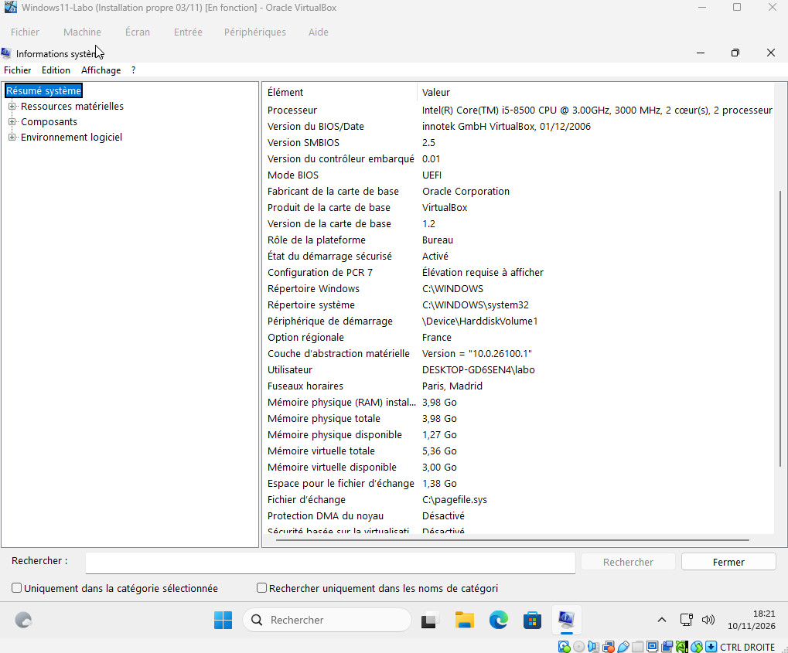
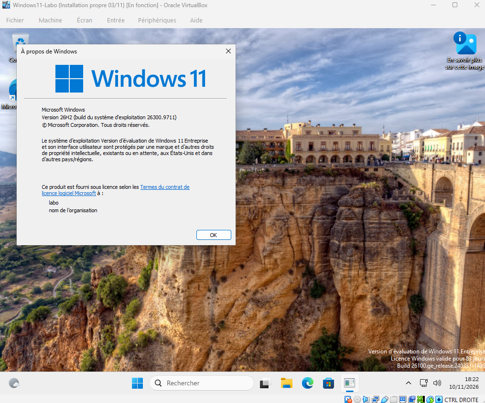
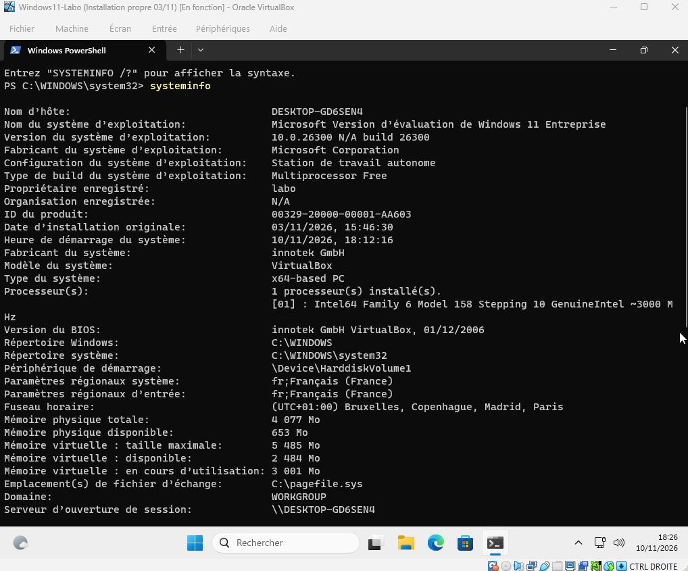
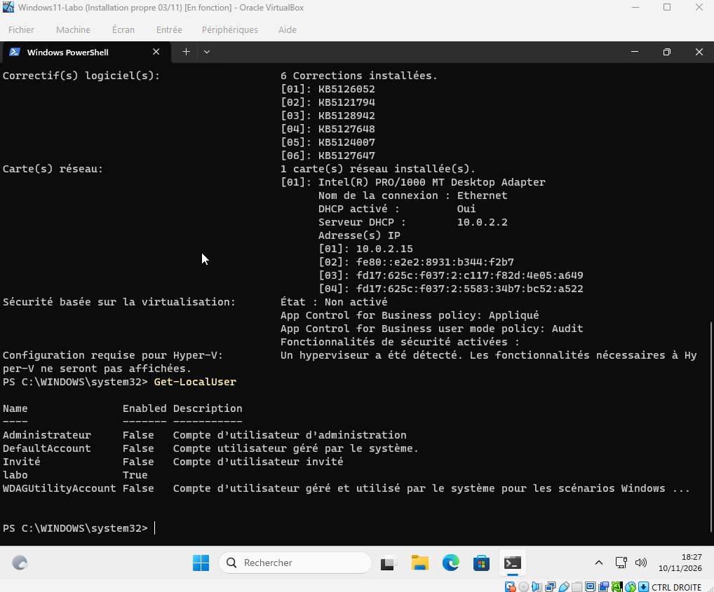

# Lab 06 – La carte d'identité d'un poste : VM et PC hôte

**Date :** 10 novembre 2026
**Compétences :** inventaire matériel et logiciel, outils Windows (msinfo32, winver), PowerShell (`systeminfo`, `Get-LocalUser`), audit des comptes locaux

## Contexte

Au support, la première chose à faire sur un poste inconnu est de savoir **à quoi on a affaire** : quel processeur, combien de mémoire, quelle version de Windows, quels comptes existent. Ces informations vont dans le ticket et évitent les allers-retours avec l'utilisateur.

Dans ce lab, j'ai relevé la « carte d'identité » de ma VM Windows11-Labo, d'abord avec les outils graphiques, puis en PowerShell, et je l'ai comparée à mon PC hôte.

## Environnement

| Élément | Détail |
|---|---|
| Poste hôte | Windows 11 Famille, Intel Core i5-8500, 16 Go de RAM |
| Hyperviseur | VirtualBox |
| VM | Windows11-Labo (Windows 11 Entreprise, version d'évaluation), voir [lab 04](../04-vm-windows-11/) |

## Démarche

### 1. À la main, avec les outils graphiques

**msinfo32** (Windows + R, puis `msinfo32`) : processeur, mode BIOS, démarrage sécurisé, mémoire.



**winver** (Windows + R, puis `winver`) : version et build de Windows.



### 2. En PowerShell

Les mêmes informations, mais en texte : on peut les copier directement dans un ticket.

```powershell
# Résumé complet du poste : système, build, processeur, mémoire, correctifs, réseau
systeminfo

# Liste des comptes locaux et de leur état (Enabled = True : compte actif)
Get-LocalUser
```





Pour le PC hôte, j'ai utilisé mon script [diagnostic-pc](https://github.com/remi-deleo/diagnostic-pc), qui regroupe ces relevés dans un rapport.

## Résultat : la carte d'identité comparée

| Élément | VM Windows11-Labo | PC hôte |
|---|---|---|
| Système | Windows 11 Entreprise (évaluation), 26H2, build 26300 | Windows 11 Famille, build 26300 |
| Fabricant / modèle | innotek GmbH / **VirtualBox** | Matériel physique |
| Processeur | i5-8500, **2 cœurs** attribués | i5-8500, 6 cœurs |
| Mémoire | **4 Go** | 16 Go |
| Mode BIOS | UEFI, démarrage sécurisé activé | – |
| Réseau | Carte Intel PRO/1000 virtuelle, DHCP, IP 10.0.2.15 (NAT de VirtualBox) | Wi-Fi, réseau de la box |
| Correctifs installés | 6 | Dernier le 16/10/2026 |
| Comptes locaux actifs | **labo** seulement (Administrateur, Invité, DefaultAccount, WDAGUtilityAccount désactivés) | **PC Principal** seulement |

## Ce que j'ai observé

- **La VM ne voit que ce que l'hyperviseur lui donne.** Elle affiche le vrai processeur (i5-8500), mais avec seulement les 2 cœurs et les 4 Go de RAM que je lui ai attribués. La carte mère, le BIOS et la carte réseau sont **virtuels** : c'est la couche d'abstraction de VirtualBox, vue en vrai.
- **L'adresse 10.0.2.15 avec le serveur DHCP 10.0.2.2** est la signature du mode NAT de VirtualBox : la VM est dans son propre petit réseau, derrière le PC hôte.
- **Les comptes intégrés sont désactivés par défaut** (Administrateur, Invité). Un seul compte est actif sur chaque machine.

## Angle sécurité

- **Auditer les comptes locaux** avec `Get-LocalUser` est un réflexe d'analyste : un compte actif inconnu, ou un compte Invité réactivé, est un signal d'alerte.
- **Point d'amélioration sur mon PC hôte :** mon compte du quotidien, PC Principal, est administrateur. La bonne pratique est d'utiliser un compte **standard** au quotidien et de garder un compte administrateur séparé pour l'installation et la configuration.
- **Le démarrage sécurisé (Secure Boot)** empêche le chargement d'un système ou d'un pilote non signé au démarrage. Il fait partie des prérequis de Windows 11.

## Ce que j'ai appris

- `msinfo32` et `winver` répondent vite à « qu'est-ce que c'est comme machine ? » ; `systeminfo` donne la même chose en texte, plus les correctifs et le réseau.
- Une VM permet de s'entraîner sans risque, mais ses « composants » sont des choix de configuration, pas du matériel.
- **Côté support :** joindre la sortie de `systeminfo` à un ticket fait gagner du temps au technicien suivant.
