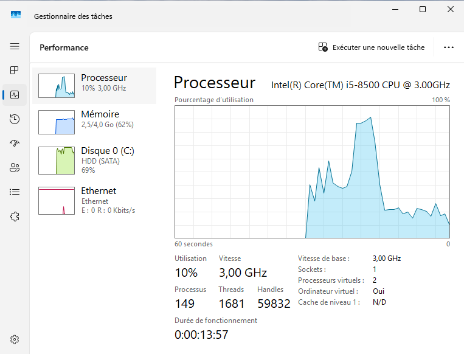
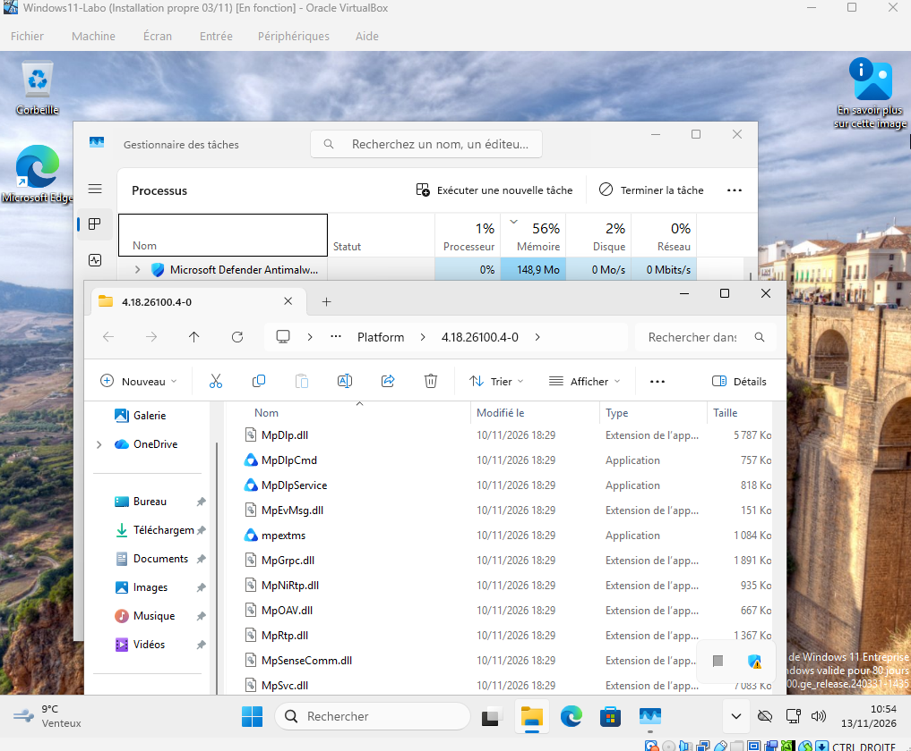
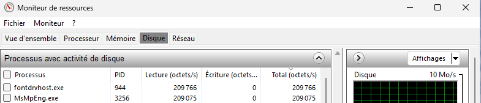
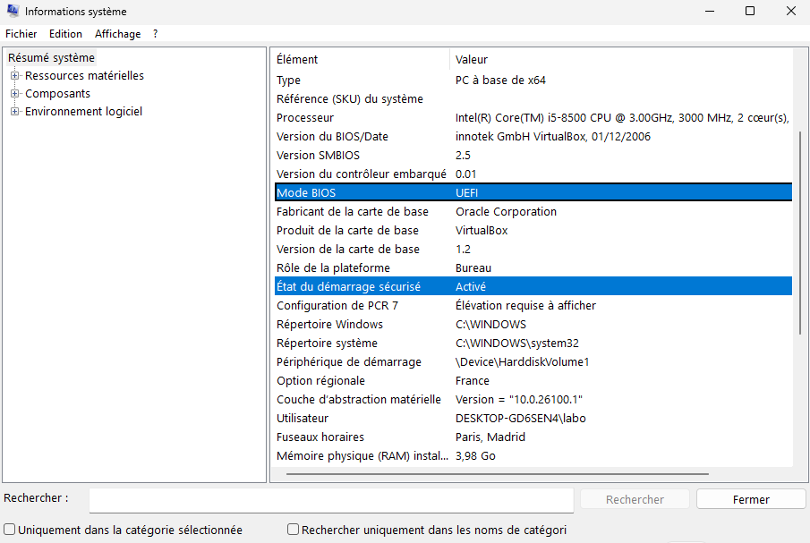

# Lab 07 – « Mon PC est lent » : lire les ressources d'un poste Windows

**Date :** 13 novembre 2026
**Compétences :** diagnostic de lenteur, Gestionnaire des tâches, Moniteur de ressources (`resmon`), `msinfo32`, vérification de l'emplacement d'un processus

## Contexte

« Mon PC est lent » est l'un des tickets les plus fréquents au support. Avant de proposer quoi que ce soit (fermer des programmes, ajouter de la RAM), le technicien **mesure** : processeur, mémoire, disque. Il vérifie aussi que le programme qui consomme le plus est bien légitime : c'est là que le support rejoint la sécurité.

Dans ce lab, j'ai fait ce diagnostic sur ma VM Windows11-Labo, quelques minutes après son démarrage.

## Environnement

| Élément | Détail |
|---|---|
| Poste hôte | Windows 11, Intel Core i5-8500, 16 Go de RAM, VM stockées sur un disque mécanique (HDD) |
| Hyperviseur | VirtualBox |
| VM | Windows11-Labo (Windows 11 Entreprise, évaluation) : 2 processeurs, 4 Go de RAM, voir [lab 04](../04-vm-windows-11/) |

## Démarche

### 1. Vue d'ensemble : Gestionnaire des tâches, onglet Performances

Ctrl + Maj + Échap, puis l'onglet **Performances**.

| Ressource | Relevé | Lecture |
|---|---|---|
| Processeur | i5-8500, **2 processeurs virtuels**, 10 % (après un pic vers 70 %) | Pas de saturation durable |
| Mémoire | **2,5 Go sur 4,0 Go** (62 %) | Correct, mais peu de marge |
| Disque | **HDD (SATA), 69 % d'activité** | La ressource la plus chargée |
| Durée de fonctionnement | 13 min 57 s | VM tout juste démarrée |

Le Gestionnaire des tâches indique aussi **« Ordinateur virtuel : Oui »** : Windows sait qu'il tourne dans une VM.

### 2. Qui consomme ? Onglet Processus, puis emplacement du fichier

Tri sur la colonne **Mémoire**, puis clic droit sur le premier processus et **« Ouvrir l'emplacement du fichier »**.

Le processus le plus gourmand est **Microsoft Defender Antimalware** (148,9 Mo). Ses fichiers se trouvent dans le dossier `Platform\4.18.26100.4-0` de Windows Defender, avec des noms attendus (`MpSvc.dll`, `MpDlpService`…).

### 3. Qui fait travailler le disque ? Moniteur de ressources

Windows + R, puis `resmon`, onglet **Disque**.

| Processus | PID | Lecture | Écriture |
|---|---|---|---|
| `fontdrvhost.exe` (pilote d'affichage des polices) | 944 | ~210 Ko/s | 0 |
| `MsMpEng.exe` (moteur de Defender) | 3256 | ~209 Ko/s | 0 |

### 4. Vérification du démarrage : msinfo32

Windows + R, puis `msinfo32` (détaillé dans le [lab 06](../06-carte-identite-poste/)).

Mode BIOS **UEFI**, démarrage sécurisé **activé**, mémoire physique **3,98 Go**.

## Diagnostic

Si un utilisateur m'avait appelé avec cette VM, mon ticket aurait été :

> **Symptôme :** lenteur dans les minutes qui suivent le démarrage.
> **Constat :** processeur et mémoire non saturés ; disque mécanique à 69 % d'activité. Defender (`MsMpEng.exe`) fait partie des processus qui lisent le plus le disque.
> **Cause probable :** activité normale de démarrage (analyse antivirus, chargement des services) sur un disque mécanique, lent par nature.
> **Action :** aucune intervention urgente ; recontrôler après 10 à 15 minutes. Si la lenteur persiste au quotidien, proposer un SSD plutôt que de la RAM.

## Angle sécurité

- **Vérifier l'emplacement d'un processus** est le premier réflexe face à un programme gourmand ou inconnu. Un faux processus se trahit souvent par son dossier (`AppData\Local\Temp`, par exemple) ou par un nom imité (`svch0st.exe` au lieu de `svchost.exe`).
- **Nuance apprise ici :** un programme légitime ne vit pas toujours dans `System32` ou `Program Files`. Defender se met à jour dans son propre dossier `Platform`, avec un numéro de version. Le dossier seul ne suffit donc pas : on regarde aussi le nom, l'éditeur et la signature numérique (clic droit, Propriétés, onglet Signatures numériques).
- **Face à un processus vraiment suspect**, on ne le supprime pas, on ne le ferme pas et on n'éteint pas le poste : on note les faits (nom, chemin, consommation, heure, poste) et on escalade à l'équipe sécurité, qui a besoin des traces intactes.
- **« Ordinateur virtuel : Oui »** : certains logiciels malveillants testent ce genre d'indice et restent inactifs dans une VM pour échapper aux analystes. C'est une raison pour laquelle l'analyse de malwares se fait dans des environnements préparés pour paraître « réels ».

## Ce que j'ai appris

- **Mesurer avant de conclure** : ici, le goulot d'étranglement était le disque, pas la RAM.
- **Le disque mécanique (HDD)** explique une bonne partie de la lenteur de ma VM, comme je l'avais constaté à l'installation (lab 04).
- **Le trio Gestionnaire des tâches, `resmon`, `msinfo32`** répond en quelques minutes à « qu'est-ce qui ralentit ce poste ? ».
- **Côté support :** un ticket utile contient des chiffres (pourcentages, nom du processus, durée de fonctionnement), pas seulement « PC lent, résolu ».
