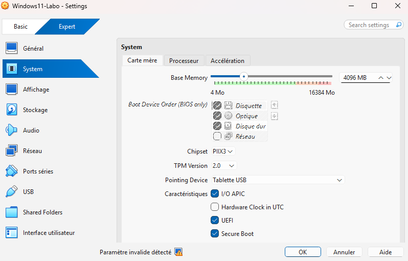
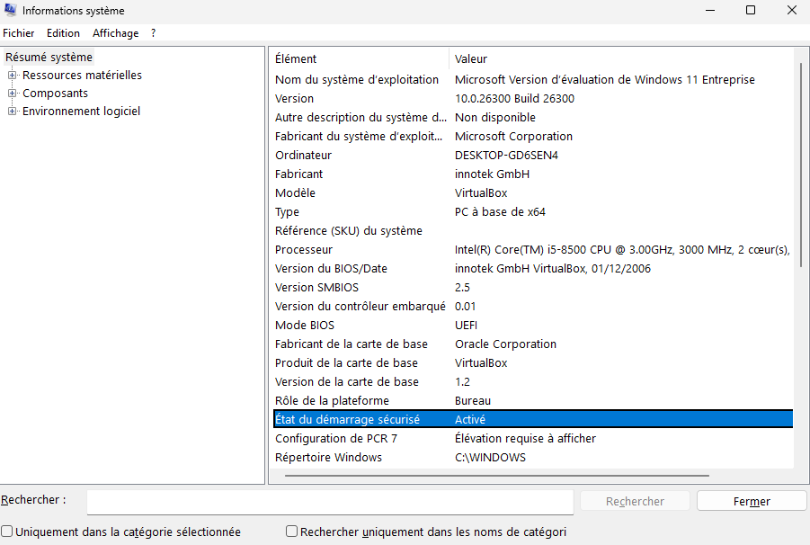
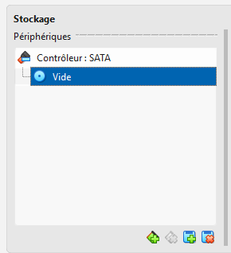
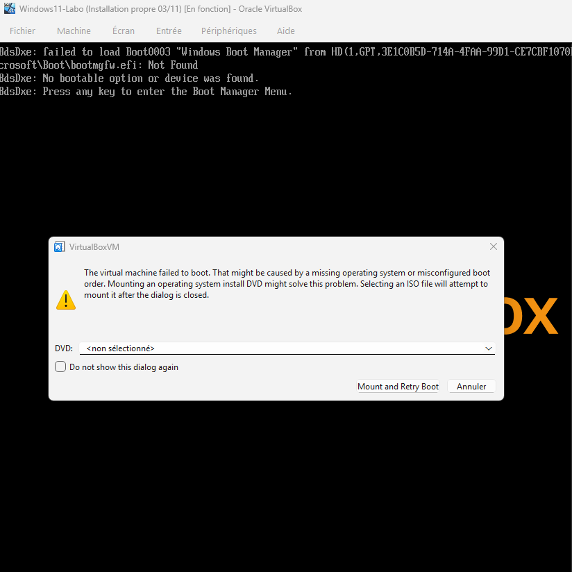
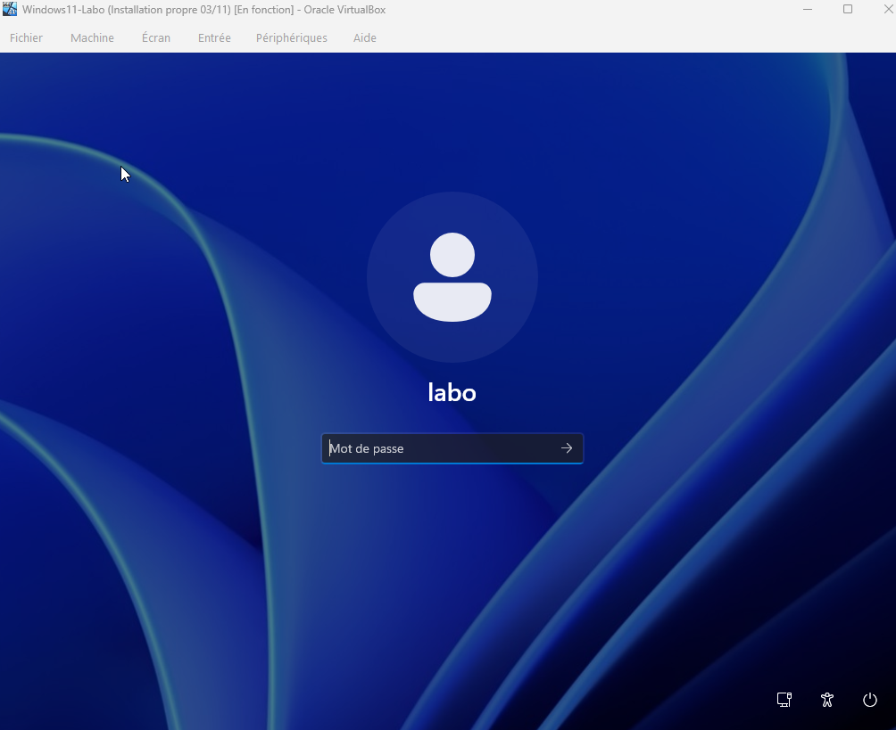

# Lab 08 – Diagnostiquer une panne de démarrage (UEFI, disque absent)

**Date :** 16-17/11/2026
**Environnement :** VirtualBox, VM `Windows11-Labo` (Windows 11 Entreprise évaluation), firmware UEFI, Secure Boot, TPM 2.0
**Compétences :** chaîne de démarrage, BIOS/UEFI, méthode de diagnostic, rédaction de ticket

## Contexte
J'ai simulé une panne courante en support : un poste qui affiche « No bootable device » au démarrage. Mon objectif était de la traiter comme un vrai ticket, du symptôme jusqu'à la solution vérifiée.

## 1. Vérification de la configuration de départ
- Dans les paramètres de la VM : **UEFI** et **Secure Boot** cochés, **TPM 2.0** activé, 4 Go de RAM.
- Dans Windows (`msinfo32`) : **Mode BIOS : UEFI** et **État du démarrage sécurisé : Activé**.

> Sur un vrai poste, `msinfo32` permet de vérifier le mode de démarrage et Secure Boot sans redémarrer.

## 2. Simulation de la panne
J'ai retiré le disque virtuel du contrôleur SATA (Configuration > Stockage). Le fichier `.vdi` n'est pas supprimé.

## 3. Ticket

| Étape | Détail |
|---|---|
| **Symptôme** | Le PC s'allume, mais Windows ne démarre pas : écran noir avec un message d'erreur. |
| **Message exact** | `BdsDxe: failed to load Boot0003 "Windows Boot Manager" from HD(...GPT...)` / `\EFI\Microsoft\Boot\bootmgfw.efi: Not Found` / `No bootable option or device was found.` |
| **Questions à l'utilisateur** | Bips ou voyants anormaux ? Une clé USB ou un disque externe est-il branché ? Une intervention ou une chute récente ? |
| **Analyse** | Pas de bip et un message affiché : le POST est passé, donc le matériel de base (CPU, RAM, carte graphique) fonctionne. Le firmware UEFI connaît encore l'entrée « Windows Boot Manager », mais ne trouve plus le fichier du bootloader (`bootmgfw.efi`). La panne se situe à l'étape **disque de démarrage**. |
| **Hypothèse** | Disque débranché, non détecté ou défaillant, ou mauvais ordre de démarrage. |
| **Test** | Vérification du stockage : aucun disque n'est attaché au contrôleur SATA. |
| **Cause** | Disque système déconnecté. |
| **Solution** | Rebrancher le disque sur le contrôleur SATA. |
| **Vérification** | La VM redémarre jusqu'à l'écran de connexion Windows. |

## 4. Rappel : la chaîne de démarrage
POST → firmware UEFI → disque de démarrage → bootloader (`bootmgfw.efi`) → noyau Windows → écran de connexion.
**L'endroit où le démarrage s'arrête indique la zone en panne.** Ici, il s'arrête après le firmware et avant le bootloader : c'est donc le stockage.

## 5. Ce que j'ai appris
- Lire un message d'erreur UEFI ligne par ligne permet de localiser la panne sans ouvrir le boîtier.
- Dans VirtualBox, le réglage « Boot Device Order » est marqué **BIOS only** : il n'a aucun effet sur une VM UEFI. En UEFI, l'ordre de démarrage se règle dans le Boot Manager du firmware (touche au démarrage).
- Angle sécurité : **Secure Boot** refuse les bootloaders non signés, ce qui bloque les bootkits. Un mot de passe BIOS/UEFI empêche de démarrer sur une clé USB pour contourner Windows. Au SOC, un Secure Boot désactivé sur un poste est une alerte à remonter.
