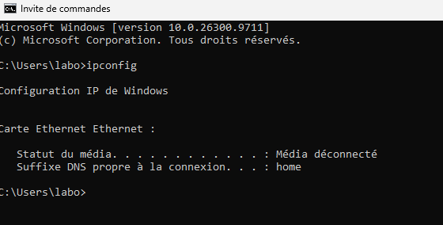

# Lab 07 – Panne réseau simulée, traitée comme un ticket

## Contexte
VM Windows 11 (VirtualBox). Objectif : diagnostiquer une perte de réseau
avec une méthode de support et la documenter comme un ticket helpdesk.

## Ticket
- **Titre** : Pas d'accès Internet – poste Windows11-Labo
- **Priorité** : basse (1 poste, contournement possible)
- **Symptôme** : la page web ne s'affiche pas
  

## Diagnostic
| Étape | Commande | Résultat | Conclusion |
|---|---|---|---|
| 1 | ipconfig | "média déconnecté" | carte réseau détecté mais pas de liaison "physique" donc pas d'accès internet | 
| 2 | ping 8.8.8.8 | "impossible de joindre l'hôte de destination" | DNS public Google inaccessible |
| 3 | ping google.fr | "impossible de joindre le site" | pas de réponse |

## Cause
Au plus simple, câble réseau débranché
## Résolution et vérification
Simulation du ranchement du câble réseau sur le port de la carte, cartes réseau reconnectée dans Virtual Box
Vérifications : de nouveau "ipconfig", "ping 8.8.8.8" et "ping google.fr". Tous répondent et la page internet s'affiche.

## Ce que j'en retiens
- Différence entre « Média déconnecté » et une adresse 169.254.x.x
- Angle sécurité : une panne sur plusieurs postes peut être un incident de sécurité plus grave
