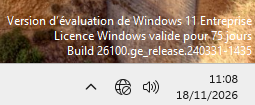
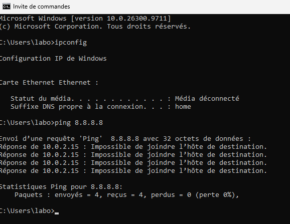
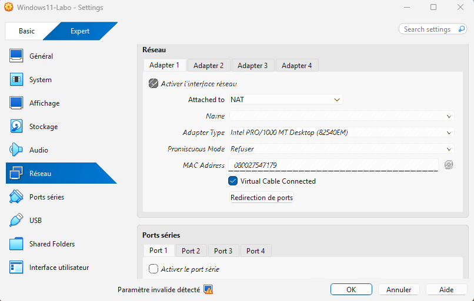
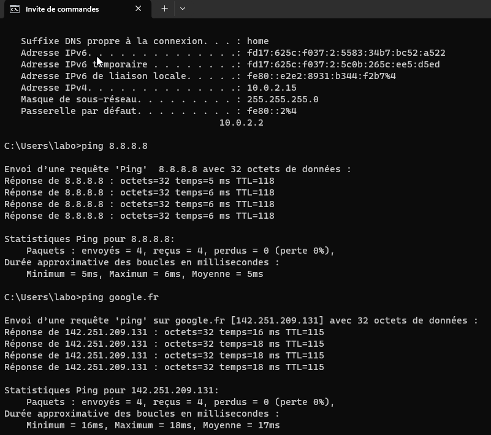

# Lab 09 – Panne réseau simulée, traitée comme un ticket

## Contexte
VM Windows 11 (VirtualBox). Objectif : diagnostiquer une perte de réseau
avec une méthode de support et la documenter comme un ticket helpdesk.

## Ticket
- **Titre** : Pas d'accès Internet – poste Windows11-Labo
- **Priorité** : basse (1 poste, contournement possible)
- **Symptôme** : la page web ne s'affiche pas

## Diagnostic
| Étape | Commande | Résultat | Conclusion |
|---|---|---|---|
| 1 | ipconfig | "Média déconnecté" | carte réseau détectée mais pas de liaison physique, donc pas d'accès Internet |
| 2 | ping 8.8.8.8 | "Impossible de joindre l'hôte de destination" | DNS public de Google injoignable |
| 3 | ping google.fr | "Impossible de joindre le site" | pas de réponse |

**Étape 1 – ipconfig pendant la panne**

**Étape 2 – ping 8.8.8.8 pendant la panne**

## Cause
Carte réseau virtuelle déconnectée dans VirtualBox (simule un câble réseau débranché).

## Résolution et vérification
Simulation du rebranchement du câble : carte réseau reconnectée dans VirtualBox (« Virtual Cable Connected » coché).

Vérifications : de nouveau `ipconfig`, `ping 8.8.8.8` et `ping google.fr`. Tous répondent et la page Internet s'affiche.

## Ce que j'en retiens
- Différence entre « Média déconnecté » et une adresse 169.254.x.x
- Angle sécurité : une panne sur plusieurs postes peut être un incident de sécurité plus grave
