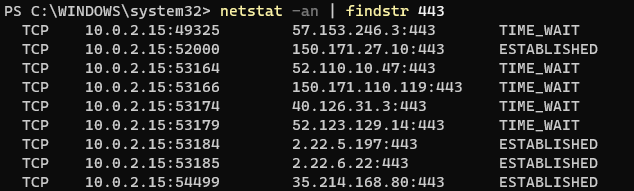

# Lab 10 : lire le réseau couche par couche (OSI / TCP-IP)

**Date :** 23/11/2026
**Environnement :** VirtualBox, VM `Windows11-Labo` (Windows 11 Entreprise évaluation), réseau en mode NAT
**Compétences :** modèle OSI / TCP-IP, ipconfig, ping, arp, nslookup, netstat, méthode de dépannage

## Contexte
Dans une VM Windows 11 (VirtualBox, mode NAT), j'ai relevé avec des commandes de base ce que chaque couche du modèle OSI montre concrètement. Objectif : apprendre à dépanner une panne réseau en partant du bas (câble, puis adresse, puis service).

## Démarche
Pour chaque commande, j'ai noté la couche OSI concernée et ce que j'ai observé.

| Commande | Couche OSI | Résultat observé |
|---|---|---|
| `ipconfig /all` (IPv4) | 3 – Réseau | 10.0.2.15 |
| `ipconfig /all` (adresse physique) | 2 – Liaison | 08-00-27-54-71-79 |
| `ipconfig /all` (passerelle, DNS) | 3 / 7 | 10.0.2.2 / 192.168.1.1 |
| `ping 10.0.2.2` | 3 – Réseau (ICMP) | 4 envoyés, 4 reçus, 0 perdu, < 1 ms |
| `arp -a` | 2 – Liaison | 10.0.2.2 = 52-54-00-12-35-00 (dynamique) |
| `nslookup microsoft.com` | 7 – Application | serveur lan.home (192.168.1.1) ; 150.171.110.121 + une adresse IPv6 |
| `netstat -an \| findstr 443` | 4 – Transport | 10.0.2.15:52000 → 150.171.27.10:443, ESTABLISHED |

## Ce que j'ai compris
- Le préfixe 08-00-27 de ma MAC et les adresses 10.0.2.x montrent que ma carte est virtuelle et que la VM est en mode NAT.
- L'adresse IP de destination reste la même de bout en bout, alors que la MAC utilisée est celle de la passerelle : l'IP sert à aller loin, la MAC sert à traverser le réseau local.
- Mon DNS est ma box (lan.home) : elle a répondu depuis son cache (« réponse ne faisant pas autorité »).
- Un navigateur ouvre de nombreuses connexions TCP en parallèle ; ESTABLISHED = connexion active, TIME_WAIT = connexion qui vient de se terminer.

## Méthode de dépannage retenue
1. Couche 1 : câble, voyants, Wi-Fi.
2. Couche 2 : bon réseau, bonne MAC dans `arp -a`.
3. Couche 3 : `ipconfig` (une adresse en 169.254.x.x = pas de DHCP), puis `ping` vers la passerelle.
4. Couche 7 : `nslookup`. Si le ping vers une IP marche mais pas vers un nom, le DNS est en cause.

## Limites
Relevés faits en NAT : on ne voit que la passerelle virtuelle et pas les autres machines du réseau local.
