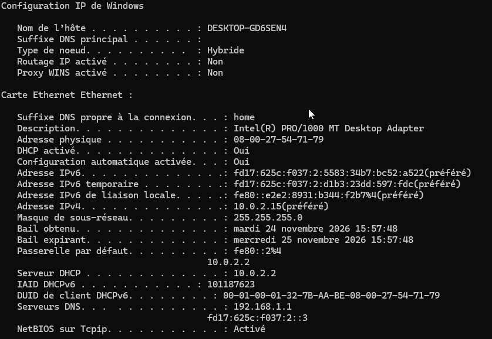

# Lab 11 — Pannes DNS et DHCP : lire les symptômes couche par couche

> Date : 24/11/2026 · VM : Windows11-Labo (VirtualBox, Windows 11 Entreprise évaluation)
> Thème : DNS · DHCP · APIPA (169.254) · ipconfig, ping, nslookup

## Objectif

Provoquer deux pannes réseau courantes en support, puis les diagnostiquer et les réparer en remontant les couches de bas en haut :

1. **Panne DNS** : le réseau fonctionne (ping par adresse IP) mais les noms ne se résolvent plus.
2. **Panne DHCP** : le poste ne reçoit aucune adresse et s'attribue une adresse APIPA en `169.254.x.x`.

## Rappel : modèle de référence

| Élément | OSI | TCP/IP | Équipement / service |
|---|---|---|---|
| Adresse MAC | 2 (Liaison) | 1 (Accès réseau) | carte réseau, switch |
| IPv4, masque, passerelle | 3 (Réseau) | 2 (Internet) | routeur |
| DNS, DHCP | 7 (Application) | 4 (Application) | serveurs de services |

## Partie 1 — Relevé de l'état normal (`ipconfig /all`)

| Élément | Valeur | OSI | TCP/IP |
|---|---|---|---|
| IPv4 | 10.0.2.15 | 3 | 2 |
| Masque | 255.255.255.0 (/24) | 3 | 2 |
| Passerelle | 10.0.2.2 | 3 | 2 |
| Serveur DHCP | 10.0.2.2 | 7 | 4 |
| Serveur DNS | 192.168.1.1 | 7 | 4 |
| MAC (physique) | 08-00-27-54-71-79 | 2 | 1 |

Remarques :
- Le réseau est `10.0.2.0/24`, une plage privée (`10.0.0.0/8`). VirtualBox en mode NAT fait à la fois passerelle et serveur DHCP.
- Le DNS `192.168.1.1` est hors du réseau de la VM : il est joint en passant par la passerelle.
- Le préfixe `08-00-27` de la MAC est celui attribué à VirtualBox : l'adresse trahit une machine virtuelle.

## Partie 2 — Panne DNS

### Problème
Un utilisateur répond : « Je n'ai plus Internet. » Le ping par adresse fonctionne, pas par nom.

### Manipulation
Dans les propriétés de la carte Ethernet : serveur DNS IPv4 remplacé à la main par `10.0.2.99` (adresse inexistante). Cache vidé avec `ipconfig /flushdns`.

### Démarche (de bas en haut)
1. `ping 8.8.8.8` : réponses → couches 1 à 3 OK (câble, IP, passerelle, routage).
2. `ping google.fr` : échec « Impossible de trouver l'hôte » → problème de résolution de noms (couche 7).
3. `ipconfig /all` : serveur DNS configuré = `10.0.2.99`.
4. `nslookup google.fr` : délai d'attente dépassé.
5. `nslookup google.fr 8.8.8.8` : réponse correcte → le réseau est sain, c'est le serveur DNS configuré qui ne répond pas.

### Cause
Serveur DNS erroné (`10.0.2.99`, adresse inexistante) saisi dans les propriétés IPv4 de la carte.

### Solution
Remettre « Obtenir les adresses des serveurs DNS automatiquement », puis `ipconfig /flushdns` pour vider le cache. `ping google.fr` fonctionne à nouveau.

## Partie 3 — Panne DHCP (APIPA)

### Problème
Le poste n'a plus accès à rien : ni Internet, ni les ressources du réseau.

### Manipulation
Passage de la carte de la VM du mode **NAT** au mode **Réseau interne** : aucun serveur DHCP n'y répond.

### Démarche (de bas en haut)
1. `ipconfig /all` : IPv4 = `169.254.x.x`, pas de passerelle, pas de serveur DHCP, mention « configuré automatiquement ».
2. `ping 8.8.8.8` : échec → la couche 3 ne sort plus du poste.
3. `ping google.fr` : échec → sans réseau, pas de résolution non plus.
4. `ipconfig /release` puis `ipconfig /renew` : toujours sans réponse du serveur DHCP.

### Cause
Aucun serveur DHCP joignable. Windows s'attribue alors une adresse **APIPA** en `169.254.0.0/16`, non routable. C'est le signe typique « pas de DHCP ».

### Solution
Remettre la carte en mode **NAT**, puis `ipconfig /renew` : l'adresse `10.0.2.15` revient.

## Ce que j'en retiens

- **Ping IP OK + nom KO = DNS** (couche 7).
- **Adresse en 169.254 = pas de DHCP** : on regarde le câble, le Wi-Fi, puis le serveur DHCP. Si plusieurs collègues sont touchés, c'est une panne serveur : escalade au N2.
- On diagnostique **de bas en haut** : câble, adresse IP, passerelle, DNS.
- Angle sécurité : un serveur DHCP pirate ou un DNS modifié peut rediriger tout le trafic d'un poste. Une passerelle ou un DNS inattendu doit faire douter.
- Commandes utilisées : `ipconfig /all`, `/release`, `/renew`, `/flushdns` · `ping` · `nslookup`.
