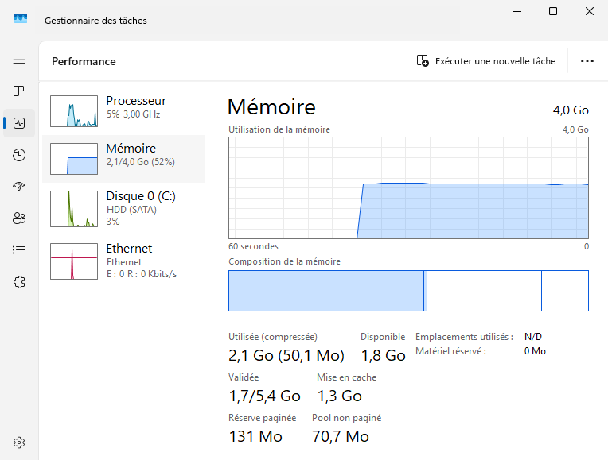
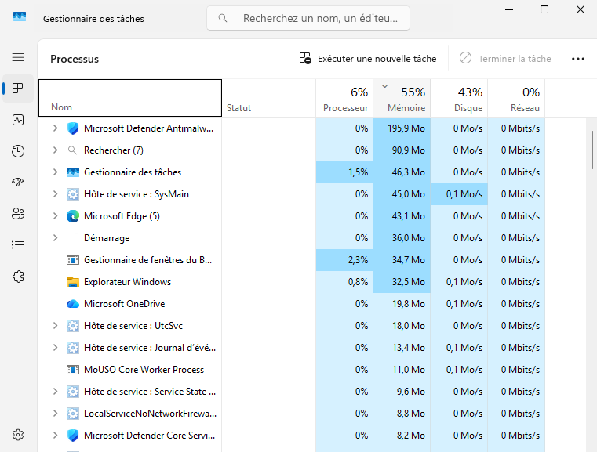
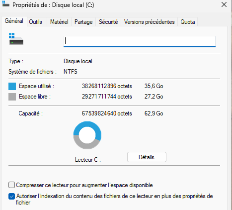
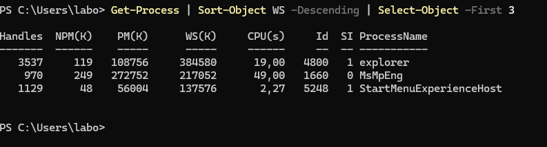
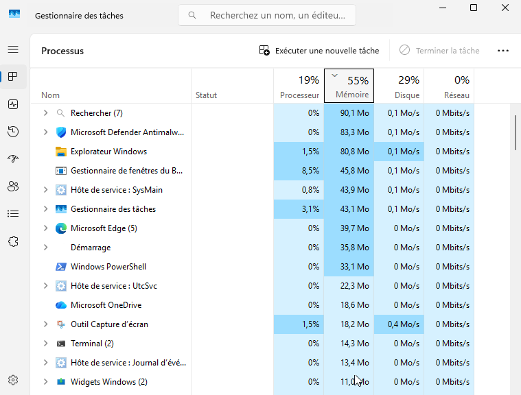
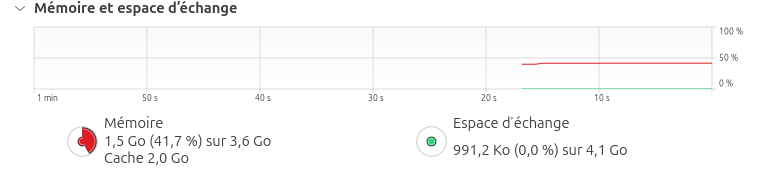
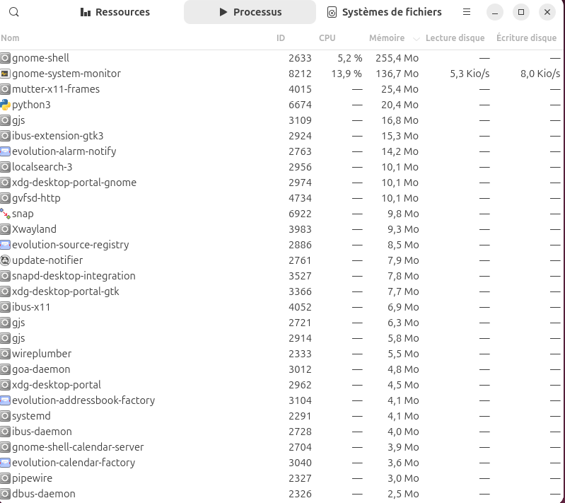
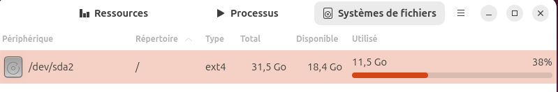
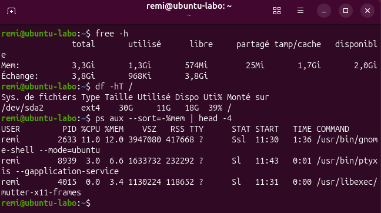

# Lab 12 — Windows et Ubuntu côte à côte : processus, mémoire et système de fichiers

> Date : 26/11/2026 · VM : Windows11-Labo et ubuntu-labo (VirtualBox, 4 Go de RAM et 2 processeurs chacune)
> Thème : système d'exploitation · processus · RAM, pagefile et swap · NTFS et ext4 · Gestionnaire des tâches, PowerShell, Bash

## Objectif

Relever les mêmes informations sur deux systèmes d'exploitation, d'abord avec l'interface graphique, puis en ligne de commande, et comparer :

1. la mémoire vive (RAM) et la mémoire d'échange (pagefile sous Windows, swap sous Linux) ;
2. les processus qui consomment le plus de mémoire ;
3. le système de fichiers du disque principal et l'espace libre.

En support, ce sont les trois premiers endroits à regarder sur un ticket « mon PC est lent » ou « je n'ai plus de place ».

## Résultats

| | Windows 11 | Ubuntu |
|---|---|---|
| RAM totale / utilisée (au repos) | 4,0 Go / 2,1 Go (52 %) | 3,6 Go / 1,5 Go (41,7 %) |
| Mémoire en cache | 1,3 Go | 2,0 Go |
| Mémoire d'échange | pagefile : environ 1,4 Go (mémoire validée 1,7 / 5,4 Go) | swap : 4,1 Go, presque inutilisé (991 Ko) |
| Processus n°1 en mémoire | Microsoft Defender Antimalware (MsMpEng), 196 Mo | gnome-shell (interface graphique), 255 Mo |
| Système de fichiers | NTFS | ext4 |
| Disque principal / espace libre | C: : 62,9 Go, 27,2 Go libres | / (/dev/sda2) : 31,5 Go, 18,4 Go libres |

## Partie 1 — Windows 11

### Avec l'interface graphique
- Gestionnaire des tâches (Ctrl+Maj+Échap) → **Performances** → **Mémoire** : 2,1 Go utilisés sur 4,0 Go, 1,3 Go en cache.
- Onglet **Processus**, trié par mémoire : Defender, Rechercher, Gestionnaire des tâches, puis **SysMain**.
- Propriétés du disque C: : NTFS, 27,2 Go libres sur 62,9 Go.





### En PowerShell
```powershell
Get-Process | Sort-Object WS -Descending | Select-Object -First 3
```
Résultat : `explorer` (384 Mo), `MsMpEng` (Defender, 217 Mo), `StartMenuExperienceHost` (138 Mo).



### Pourquoi les chiffres ne sont pas les mêmes ?
PowerShell place l'Explorateur en tête avec 384 Mo, alors que le Gestionnaire des tâches ne lui donne que 32 à 80 Mo.
- **WS (Working Set)**, dans PowerShell, compte toute la mémoire du processus, **y compris la mémoire partagée** avec d'autres processus (bibliothèques système communes).
- Le Gestionnaire des tâches affiche par défaut la **mémoire privée**, propre au processus seul.

À retenir : on compare toujours des chiffres mesurés avec le même outil et la même unité.

Deuxième point : le classement change d'une capture à l'autre (Defender à 196 Mo, puis 83 Mo quelques minutes plus tard). Au démarrage, Defender analyse le système, puis se calme. Un relevé de performances n'est qu'une photo à un instant donné.



## Partie 2 — Ubuntu

### Avec l'interface graphique (Moniteur système)
- **Ressources** : 1,5 Go utilisé sur 3,6 Go, 2,0 Go en cache, swap de 4,1 Go presque vide.
- **Processus**, trié par mémoire : `gnome-shell` (l'interface graphique) loin devant, puis le Moniteur système lui-même.
- **Systèmes de fichiers** : `/dev/sda2` monté sur `/`, en ext4, 18,4 Go disponibles.





### Dans le terminal
```bash
free -h                       # mémoire et swap, en unités lisibles
df -hT /                      # disque principal, avec le type de système de fichiers
ps aux --sort=-%mem | head -4 # les 3 processus qui consomment le plus de mémoire
```



### Pourquoi 3,3 et pas 3,6 ?
Le terminal affiche **3,3 Gi** de RAM, le Moniteur système **3,6 Go**. C'est la même quantité, mesurée dans deux unités :
- **Gi (gibioctet)** = 1 024 × 1 024 × 1 024 octets ;
- **Go (gigaoctet)** = 1 000 × 1 000 × 1 000 octets.

C'est aussi pour ça qu'un disque vendu « 1 To » apparaît comme 931 Go sous Windows, une question fréquente des utilisateurs.

## Ce que j'en retiens

- **Une RAM « bien remplie » au repos n'est pas une panne.** Les deux systèmes utilisent la mémoire libre comme cache pour accélérer les programmes : sous Windows, c'est le service **SysMain** visible dans la liste ; sous Linux, c'est la colonne `tamp/cache` de `free -h`. Cette mémoire est rendue dès qu'une application en a besoin. Le vrai signe d'alerte, c'est un fichier d'échange très sollicité, avec un disque qui tourne en continu.
- **Windows consomme plus au repos** : antivirus, indexation de la recherche, télémétrie (UtcSvc) et mises à jour tournent en permanence.
- **Côté sécurité**, sous Windows, l'antivirus est le processus le plus gourmand au démarrage : c'est normal, et il ne faut jamais le désactiver pour « gagner de la RAM ». Inversement, un processus inconnu qui consomme beaucoup mérite qu'on regarde l'emplacement de son fichier (clic droit → **Ouvrir l'emplacement du fichier**).
- **NTFS et ext4** sont les systèmes de fichiers par défaut de chaque OS. Ni l'un ni l'autre n'est lisible nativement partout : pour une clé USB à partager, on choisit exFAT.
- **Une même info, deux outils** : l'interface graphique pour expliquer à un utilisateur, la ligne de commande pour aller vite, faire un script ou intervenir à distance.
